<a href="https://www.jordanco.club"><picture><source media="(prefers-color-scheme: dark)" srcset="assets/hero-oscuro.svg"></picture></a>

<picture><source media="(prefers-color-scheme: dark)" srcset="assets/terminal-oscuro.svg"></picture>

<picture><source media="(prefers-color-scheme: dark)" srcset="assets/servicios-oscuro.svg"></picture>

<picture><source media="(prefers-color-scheme: dark)" srcset="assets/stack-oscuro.svg"></picture>

<picture><source media="(prefers-color-scheme: dark)" srcset="assets/proyectos-oscuro.svg"></picture>
<a href="https://aidencol.vercel.app"><picture><source media="(prefers-color-scheme: dark)" srcset="assets/proyecto-aiden-oscuro.svg"></picture></a><a href="https://aragons.vercel.app"><picture><source media="(prefers-color-scheme: dark)" srcset="assets/proyecto-aragon-oscuro.svg"></picture></a>
<a href="https://www.jordanco.club/projects/aragon-server"><picture><source media="(prefers-color-scheme: dark)" srcset="assets/proyecto-aragon-server-oscuro.svg"></picture></a><a href="https://www.jordanco.club"><picture><source media="(prefers-color-scheme: dark)" srcset="assets/proyecto-portafolio-oscuro.svg"></picture></a>
<a href="https://leidymicolta.vercel.app"><picture><source media="(prefers-color-scheme: dark)" srcset="assets/proyecto-leidy-oscuro.svg"></picture></a><a href="https://www.jordanco.club/projects/calendar"><picture><source media="(prefers-color-scheme: dark)" srcset="assets/proyecto-calendar-oscuro.svg"></picture></a>

<picture><source media="(prefers-color-scheme: dark)" srcset="assets/trayectoria-oscuro.svg"></picture>

<picture><source media="(prefers-color-scheme: dark)" srcset="assets/actividad-oscuro.svg"></picture>
<picture><source media="(prefers-color-scheme: dark)" srcset="https://raw.githubusercontent.com/JordanAragon/JordanAragon/output/serpiente-oscuro.svg"></picture>

<picture><source media="(prefers-color-scheme: dark)" srcset="assets/contacto-oscuro.svg"></picture>
<a href="https://www.jordanco.club"><picture><source media="(prefers-color-scheme: dark)" srcset="assets/contacto-portafolio-oscuro.svg"></picture></a><a href="https://aragons.vercel.app"><picture><source media="(prefers-color-scheme: dark)" srcset="assets/contacto-aragon-oscuro.svg"></picture></a><a href="https://www.linkedin.com/in/jordanaragon"><picture><source media="(prefers-color-scheme: dark)" srcset="assets/contacto-linkedin-oscuro.svg"></picture></a><a href="mailto:jordandavidaragon@outlook.com"><picture><source media="(prefers-color-scheme: dark)" srcset="assets/contacto-correo-oscuro.svg"></picture></a>

<picture><source media="(prefers-color-scheme: dark)" srcset="assets/cierre-oscuro.svg"></picture>
